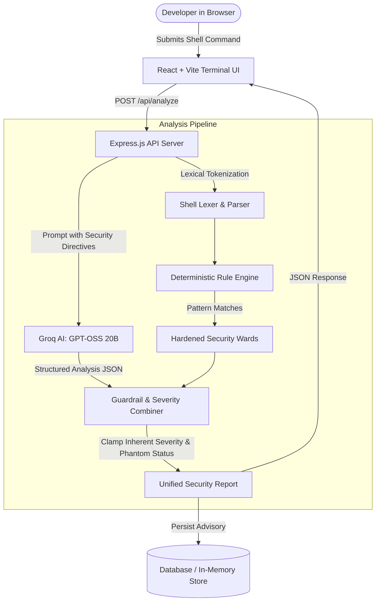

#  Terminal Poltergeist

> *"Every command has consequences. Let the ghost reveal them."*

**Terminal Poltergeist** is an AI-powered shell command analysis and safety assistant. Developers paste unfamiliar, suspicious, or complex shell scripts into a haunted terminal interface and receive an instant breakdown of what each flag and pipe does, potential destructive hazards, privilege escalations, affected operating system resources, phantom/non-existent binary warnings, and safer alternatives.

**Submitted commands are NEVER executed.** Terminal Poltergeist evaluates commands strictly as untrusted static data using a dual-defense architecture: a deterministic security rule engine paired with open-weight **GPT-OSS 20B** inference via **Groq**.

---

## 🎃 Table of Contents

1. [Features & Capabilities](#-features--capabilities)
2. [Dual-Defense Architecture](#-dual-defense-architecture)
3. [Security Rule Engine](#-security-rule-engine)
4. [Phantom & Non-Existent Command Detection](#-phantom--non-existent-command-detection)
5. [Tech Stack](#-tech-stack)
6. [Project Structure](#-project-structure)
7. [API Specification](#-api-specification)
8. [Local Development Setup](#-local-development-setup)
9. [Automated Testing & QA](#-automated-testing--qa)
10. [Responsible AI & Security Disclosure](#-responsible-ai--security-disclosure)
11. [License](#-license)

---

## ⚡ Features & Capabilities

- 🛡️ **Zero-Execution Sandbox:** Analyzes commands strictly via static lexical parsing and AI inference; submitted commands are never run on either client or server.
- 🧠 **Open-Weight AI Reasoning:** Powered by `openai/gpt-oss-20b` running on Groq's high-speed inference engine for near-instant tokenization, subshell deconstruction, and flag explanations.
- 🔒 **Deterministic Static Guardrails:** Mathematical pattern matching for destructive operations: recursive root deletion (`rm -rf /`), fork bombs, raw block writes (`dd of=/dev/sdX`), insecure permissions (`chmod 777`), sensitive file tampering (`/etc/sudoers`), and unverified remote curl pipes (`curl | bash`).
- 🔍 **Phantom Binary Detection:** Detects non-existent binaries, random keyboard mashes, and common typos (e.g., `gti` → `git`, `sl` → `ls`), displaying a dedicated **COMMAND NOT FOUND (Exit Code 127)** status instead of misleading hazard levels.
- 👻 **Spectral Commentary:** Technical rigor accompanied by haunting developer folklore commentary from the machine's resident poltergeist.
- 📋 **1-Click Safer Alternatives:** Suggests verified flags, non-destructive tools, or syntax corrections with single-click clipboard copying.
- 📊 **Session History & Analytics:** Tracks analysis logs, severity breakdowns (Critical, High, Medium, Low, Phantom), and individual inspection reports.
- 🕯️ **Offline Resiliency:** Automatic fallback to local deterministic rules and in-memory storage if external services are unreachable.

---

## 🏗️ Dual-Defense Architecture

Terminal Poltergeist pairs an open-weight Large Language Model with a deterministic rule engine to eliminate AI hallucinations on critical security threats.



### Why Dual Defense?
LLMs are probabilistic and susceptible to prompt injection or novel syntax tricks. If an adversarial command embeds instructions attempting to trick the AI into declaring it safe, our deterministic rule engine detects the destructive signature, clamps the risk to **Critical**, and overrides any hallucinated safety score. Conversely, for commands without hard signatures, the open-weight model deconstructs subtle flags and complex subshells that static regexes might miss.

---

## ⚔️ Security Rule Engine

Our deterministic engine inspects compound pipelines, subshells, flags, and arguments against known security hazards:

| Rule ID | Category | Target / Signature | Severity |
| :--- | :--- | :--- | :--- |
| `RULE-FORK-BOMB` | Resource Exhaustion | `:(){ :\|:& };:` recursion | **Critical** |
| `RULE-ROOT-RM-RF` | Destructive Deletion | `rm -rf /`, `rm -rf /*`, `--no-preserve-root` | **Critical** |
| `RULE-RAW-DISK-WRITE`| Disk Destruction | `dd of=/dev/sd*`, `mkfs.* /dev/` | **Critical** |
| `RULE-SUDOERS-TAMPERING`| Privilege Escalation | `/etc/sudoers`, `/etc/shadow`, `NOPASSWD: ALL` | **Critical** |
| `RULE-REMOTE-PIPE-SHELL`| Remote Execution | `curl ... \| bash`, `wget ... \| sh` | **High** |
| `RULE-INSECURE-PERMISSIONS`| Permissions | `chmod -R 777`, `chmod a+rwx` | **High** |
| `RULE-MASS-PROCESS-KILL`| System Disruption | `kill -9 -1`, `killall -9 *` | **High** |
| `RULE-CREDENTIAL-EXPOSURE`| Credential Leak | AWS keys (`AKIA...`), inline private keys | **Medium** |
| `RULE-UNRECOGNIZED-COMMAND`| Invalid Binary Syntax | Non-existent binaries, random strings | **Low (Exit 127)** |

---

## 🔎 Phantom & Non-Existent Command Detection

Executing non-existent commands in a shell fails immediately with exit code 127 (`command not found`). They do not alter system state, compromise credentials, or destroy data. 

Terminal Poltergeist validates binaries against POSIX specifications, core developer utilities, package managers, programming runtimes, container engines, and cloud CLIs:
- **Typo Suggestions:** Automatically identifies common inversions (`gti` → `git`, `sl` → `ls`, `catt` → `cat`).
- **Dedicated Status:** Renders a distinct purple **COMMAND NOT FOUND** badge indicating exit code 127 rather than alarming developers with misleading "Medium Caution" warnings.
- **Pipeline Integrity:** If a fake command is chained to a dangerous payload (e.g. `faketool && rm -rf /`), the system correctly flags both the phantom failure and the critical security hazard.

---

## 💻 Tech Stack

- **Frontend:** React 18, Vite, Tailwind CSS, Lucide Icons, Custom Spectral CRT Canvas / CSS Animations.
- **Backend:** Node.js (ES Modules), Express.js, Prisma ORM.
- **Database:** PostgreSQL (with automatic zero-config in-memory fallback for local development).
- **AI Inference:** Groq Cloud SDK (`openai/gpt-oss-20b`).
- **Testing:** Jest, Supertest.

---

## 📁 Project Structure

```text
terminal-poltergeist/
├── client/                     # Frontend Application
│   ├── index.html              # HTML entry with custom typography
│   ├── src/
│   │   ├── components/         # UI Components
│   │   │   ├── Navbar.jsx          # Header with online/offline sentinel
│   │   │   ├── GhostHero.jsx       # Spectral hero & animated ghost SVG
│   │   │   ├── CommandTerminal.jsx # Haunted terminal input & demo chips
│   │   │   ├── AnalysisResults.jsx # Severity cards & token deconstruction
│   │   │   ├── HistoryDashboard.jsx# Session history & statistics
│   │   │   ├── AboutSection.jsx    # Technical architecture & disclosures
│   │   │   └── Footer.jsx          # Footer & links
│   │   ├── data/
│   │   │   └── demoCommands.js     # Curated demo incantations
│   │   ├── App.jsx             # Main application orchestrator
│   │   ├── main.jsx            # React root mount
│   │   └── index.css           # Spectral animations & Tailwind directives
│   ├── package.json
│   └── vite.config.js
│
├── server/                     # Backend Application
│   ├── prisma/
│   │   └── schema.prisma       # Database schema for command logs
│   ├── src/
│   │   ├── db/
│   │   │   └── prisma.js       # Prisma client with in-memory fallback
│   │   ├── rules/              # Security Rule Engine
│   │   │   ├── definitions.js  # Security rule definitions
│   │   │   ├── engine.js       # Rule evaluation & severity scoring
│   │   │   ├── knownCommands.js# POSIX & developer binary registry
│   │   │   └── parser.js       # Shell lexical tokenizer
│   │   ├── services/
│   │   │   └── ai.js           # Groq AI inference & guardrail merger
│   │   └── index.js            # Express app & API routes
│   ├── tests/                  # Automated Test Suite
│   │   ├── ai.test.js          # AI service & prompt injection tests
│   │   ├── api.test.js         # HTTP API endpoint tests
│   │   ├── edgeCases.test.js   # Parser & pipeline edge case tests
│   │   └── rules.test.js       # Security rules & phantom tests
│   └── package.json
│
└── package.json                # Root package for monorepo dev scripts
```

---

## 📡 API Specification

### `POST /api/analyze`
Submits a shell command for static security and AI analysis.

**Request Body:**
```json
{
  "command": "rm -rf /var/log/nginx/*",
  "sessionId": "anon-session-uuid"
}
```

**Response (`200 OK`):**
```json
{
  "isValid": true,
  "command": "rm -rf /var/log/nginx/*",
  "riskLevel": "High",
  "isUnrecognized": false,
  "unrecognizedBinaries": [],
  "summary": "Removes all log files inside the nginx directory recursively.",
  "components": [
    {
      "part": "rm",
      "type": "Command Unit",
      "binary": "rm",
      "flags": ["-r", "-f"],
      "explanation": "Invokes filesystem unlink utility to delete specified targets."
    }
  ],
  "consequences": [
    "Deletes existing web server log archives permanently."
  ],
  "affectedResources": [
    "Filesystem Directory (/var/log/nginx)"
  ],
  "reasons": [
    "Recursive forced deletion on system log paths"
  ],
  "saferAlternative": "logrotate -f /etc/logrotate.d/nginx",
  "ghostCommentary": "The logs vanish like mist, erasing every footprint in the midnight sand...",
  "modelMetadata": {
    "provider": "Groq",
    "model": "openai/gpt-oss-20b"
  }
}
```

### `GET /api/history`
Returns past analysis history for the current session.

### `DELETE /api/history/:id`
Deletes a specific analysis record from session history.

### `GET /api/health`
Health check endpoint reporting API status, database connectivity, and engine modes.

---

## 🚀 Local Development Setup

### Prerequisites
- **Node.js**: v18.0.0 or higher
- **npm**: v9.0.0 or higher

### 1. Clone the Repository
```bash
git clone https://github.com/CyborgX-hash/terminal-poltergeist.git
cd terminal-poltergeist
```

### 2. Install Dependencies
```bash
# Install root, backend, and frontend packages
npm install
cd server && npm install
cd ../client && npm install
cd ..
```

### 3. Start Development Servers
From the root directory, launch both backend and frontend concurrently:
```bash
npm run dev
```

Alternatively, run each service in separate terminal windows:
```bash
# Terminal 1: Backend API (runs on http://localhost:5001)
npm run dev:server

# Terminal 2: Frontend Client (runs on http://localhost:5173)
npm run dev:client
```

Open `http://localhost:5173` in your browser.

> **Offline Mode:** If no external API keys or PostgreSQL databases are configured, Terminal Poltergeist starts automatically in resilient local mode using the deterministic rule engine and in-memory session store.

---

## 🧪 Automated Testing & QA

Run the automated test suite across all 4 test modules (37 unit, integration, and security tests):

```bash
cd server
npm test
```

### Test Coverage Highlights:
- **Lexical Tokenization:** Parsing of quotes, nested subshells, chained pipes (`|`), logical operators (`&&`, `||`), and variable prefixes.
- **Hardened Rules:** Zero-hallucination detection of fork bombs, root wipes, curl-pipes, raw disk writes, and AWS credentials.
- **Phantom Detection:** Validation of unrecognized binaries (e.g., `hii`, `foobar123`), typo corrections (`gti` → `git`), and low-risk classification.
- **Prompt Injection Defense:** Neutralization of jailbreak strings within command arguments.
- **In-Memory Store:** CRUD and deletion lifecycle verification.

---

## 🛡️ Responsible AI & Security Disclosure

1. **Advisory Tool:** Terminal Poltergeist serves as an advisory assistant. No static analysis system can solve the Halting Problem or guarantee 100% detection of all possible obfuscation variants. Always exercise human judgment before running commands with elevated privileges.
2. **Untrusted Data Boundary:** All input commands are treated strictly as data strings. Commands are never passed to child processes or system shells.
3. **Session Privacy:** Analysis logs are isolated by anonymous session identifiers to ensure privacy during shared or multi-user usage.

---

## 📜 License

This project is licensed under the **MIT License**. See the [LICENSE](LICENSE) file for details.
